# Quizora

Quizora is an online quiz app for colleges. Teachers create classes and tests, students sign in with their USN and a one-time password, and the app proctors the test (fullscreen, tab-switch and webcam checks) and gives teachers per-student, per-question results.

- **Live app:** https://quiz-app-sigma-lemon-97.vercel.app
- **Teacher panel:** https://quiz-app-sigma-lemon-97.vercel.app/admin

**Contents**
- [Teacher guide](#teacher-guide)
  1. [Create an account or log in](#1-create-an-account-or-log-in)
  2. [Add your class and students](#2-add-your-class-and-students)
  3. [Create a test and add questions](#3-create-a-test-and-add-questions)
  4. [Give students their login details](#4-give-students-their-login-details)
  5. [Run the test](#5-run-the-test)
  6. [See the results](#6-see-the-results)
  7. [Manage your classes](#7-manage-your-classes)
  8. [Your profile](#8-your-profile)
- [Student guide](#student-guide)
- [Developer guide](#developer-guide)

---

## Teacher guide

### 1. Create an account or log in

Open **/admin**. If you are new, click **New teacher? Create an account**, fill in your name, email and password, and click **Send Verification Code**. Enter the 6-digit code that arrives by email and click **Create Account**.

Every teacher has a private account: you only ever see your own classes, students and tests.

| Log in | Create an account | Forgot password |
|---|---|---|
| 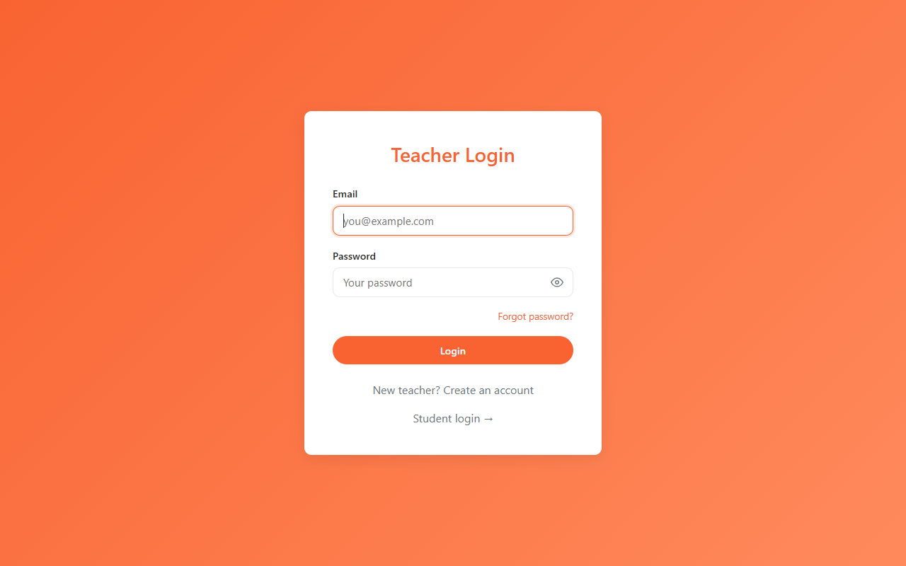 | 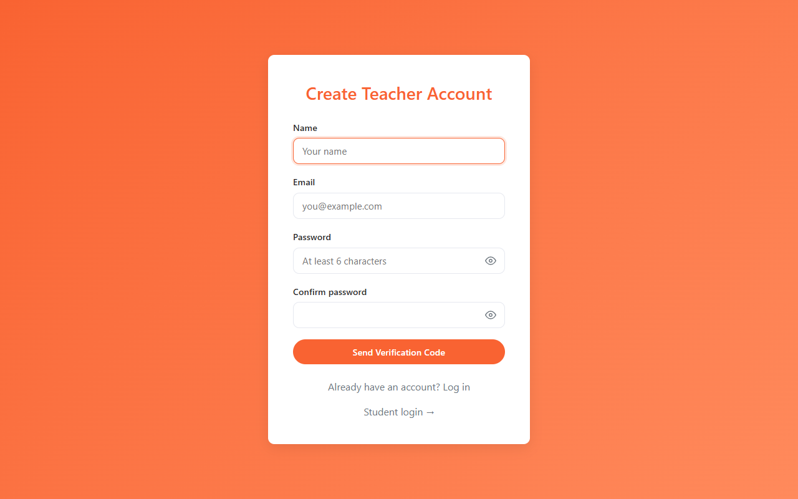 | 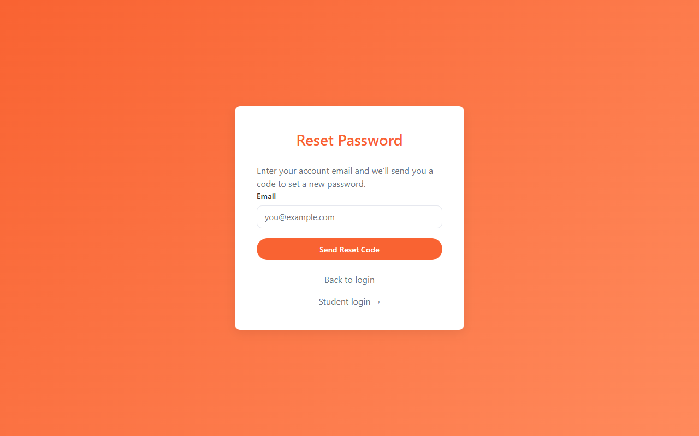 |

- **Forgot password?** Click it under the password box, enter your email, and you'll get a code to set a new password.
- The eye icon in a password box shows or hides what you typed.
- Codes are valid for 10 minutes. If one doesn't arrive, check your spam folder or click **resend code** after a minute.

### 2. Add your class and students

Go to **Add Class / Student** in the sidebar.

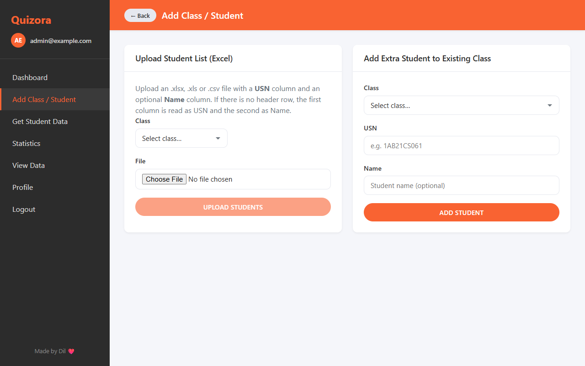

**Upload a student list (recommended).** Make an Excel (`.xlsx`, `.xls`) or `.csv` file like this:

| USN | Name |
|---|---|
| 1AB21CS001 | Asha Rao |
| 1AB21CS002 | Ravi Kumar |

The `Name` column is optional. If the sheet has no header row, column A is read as the USN and column B as the name. Choose **+ Create new class** (or an existing class), pick the file, check the count it shows, and click **Upload Students**. USNs already in the class are skipped, not duplicated.

**Add one student.** Use **Add Extra Student to Existing Class** for a late joiner.

USNs are not case-sensitive: `1ab21cs001` and `1AB21CS001` are the same student.

### 3. Create a test and add questions

On the **Dashboard**, click **+ New Test**. Fill in the name, subject, date, number of questions and class, then choose:

- **Status:** `PENDING` (students can't start yet) or `RUNNING` (students can start).
- **Mode:** `STANDARD` for a real, proctored test, or `MOCK` for practice: no timer, no proctoring, and students can retake it.
- **Enable webcam proctoring for this test:** see [Run the test](#5-run-the-test).
- **Timing:** *Per question* gives every question its own countdown (set on each question). *Total time for the whole test* gives one countdown, e.g. 30 minutes, for the whole test; questions still come one at a time with no going back, and students can **Skip** a question.
- **Shuffle questions and options for each student:** every student gets their own order of questions and of the four options, so neighbours can't copy by position. A student keeps the same order if they reconnect.

Every student in the chosen class is enrolled automatically, each with their own password.

Then open the test from the Dashboard to reach **Test Details**:

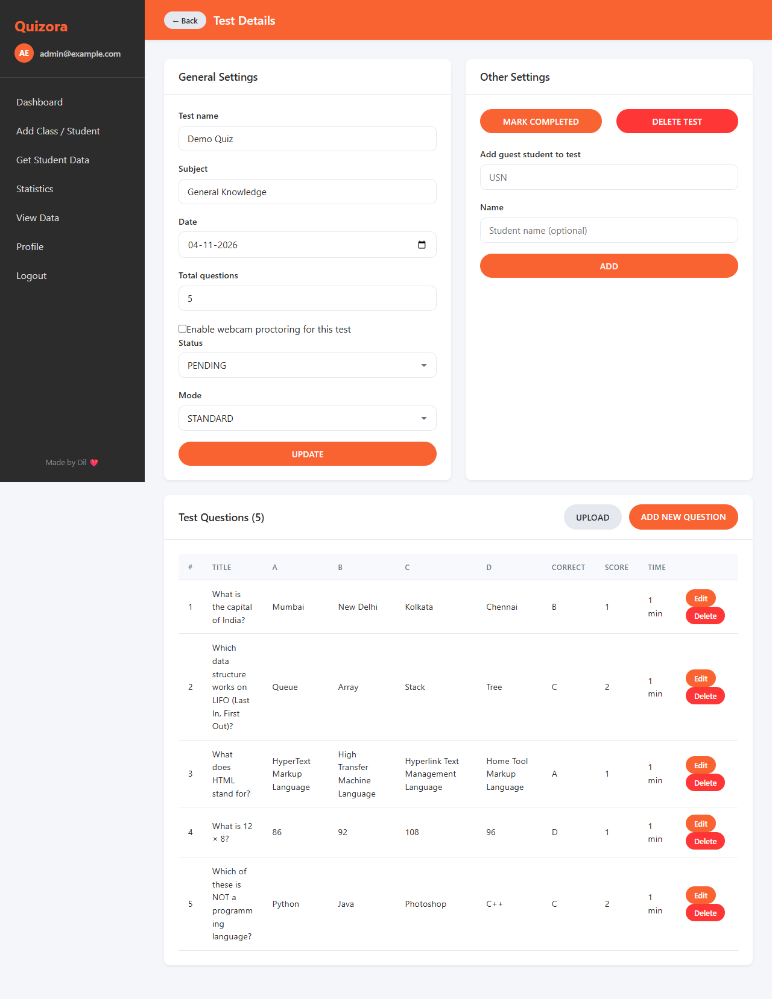

- **Add New Question:** type the question, the four options, the correct answer, the marks and the time limit (in minutes).
- **Upload:** add many questions at once from an Excel file (`.xlsx`, `.xls`, `.ods`) with **no header row** and these columns in order:
  `question | option A | option B | option C | option D | correct (a/b/c/d) | marks | time limit (minutes)`
- **Add guest student to test:** enrol someone who isn't in the class, for this test only.
- **Mark Completed:** ends the test. **Delete Test:** removes the test, its questions and its results.

### 4. Give students their login details

Go to **Get Student Data** and pick the test.

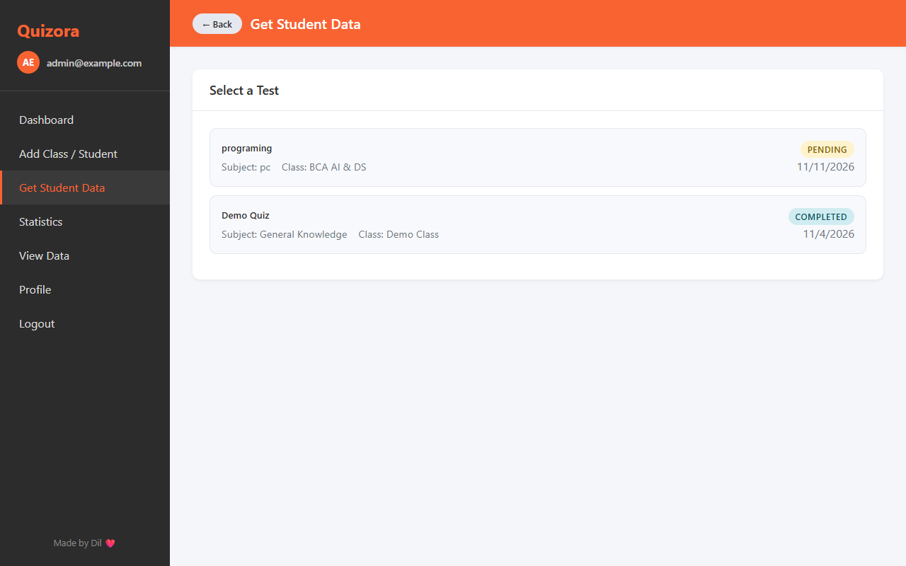

The **Student Credentials** page lists every student's USN, name and test password, plus their live status, score and any violations.

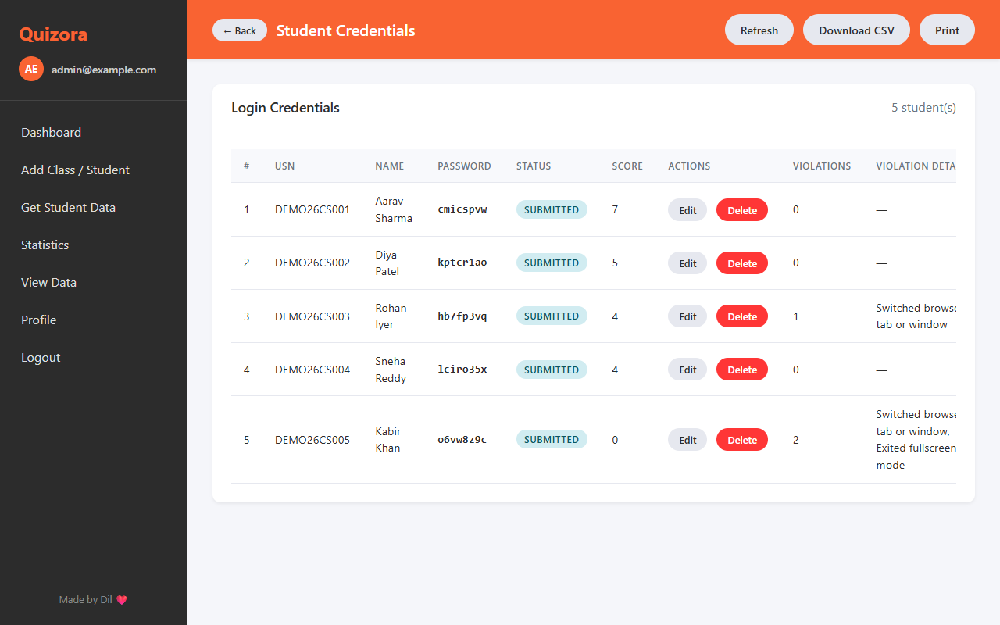

- **Print** prints only the USN and Name columns.
- **Download CSV** saves everything, including passwords, to hand out or keep.
- **Edit** fixes a student's USN or name. **Delete** removes them from this test.
- **Refresh** reloads the list while the test is running.

### 5. Run the test

Set the test's **Status** to `RUNNING` on Test Details and click **Update**. Students can now log in and start.

During a `STANDARD` test the app:
- runs in **fullscreen** and blocks right-click, copy/paste and developer tools;
- runs the **countdown** you chose: per question (when it runs out, the next question loads) or for the whole test (when it runs out, the test is submitted). The total-time deadline is kept on the server, so reloading the page doesn't give extra time;
- counts a **warning** when the student switches tab or window, leaves fullscreen, or turns the camera off;
- with **webcam proctoring** on, also watches the student's face and counts a warning if they **look away** for about 2 seconds, **leave the camera view** for 3 seconds, or **someone else appears** on camera. The preview turns red ("Look at the screen!") first, so a quick glance is not punished.

On the **3rd warning** the test is **auto-submitted**. Face tracking runs entirely in the student's browser; no video is uploaded.

When everyone has finished, click **Mark Completed**.

### 6. See the results

Go to **Statistics** and pick a completed test.


**Test Statistics** shows each student's score, whether they submitted (or were auto-submitted) and their violations. **Print** prints the #, USN, Name and Score columns.

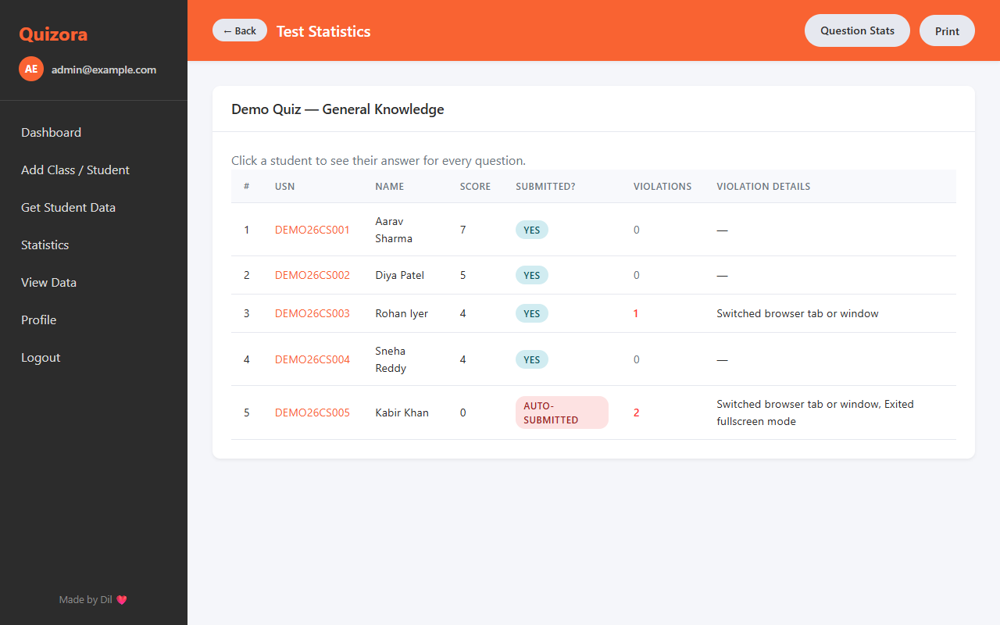

**Click a student** to see exactly what they answered for every question, with the correct answer and the marks.

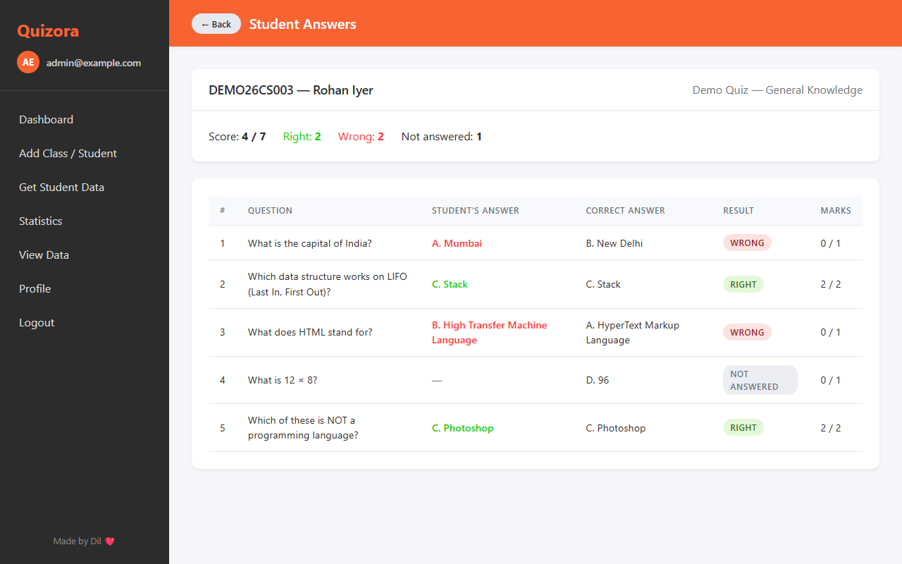

**Question Stats** shows how many students got each question right or wrong, so you can spot difficult questions.

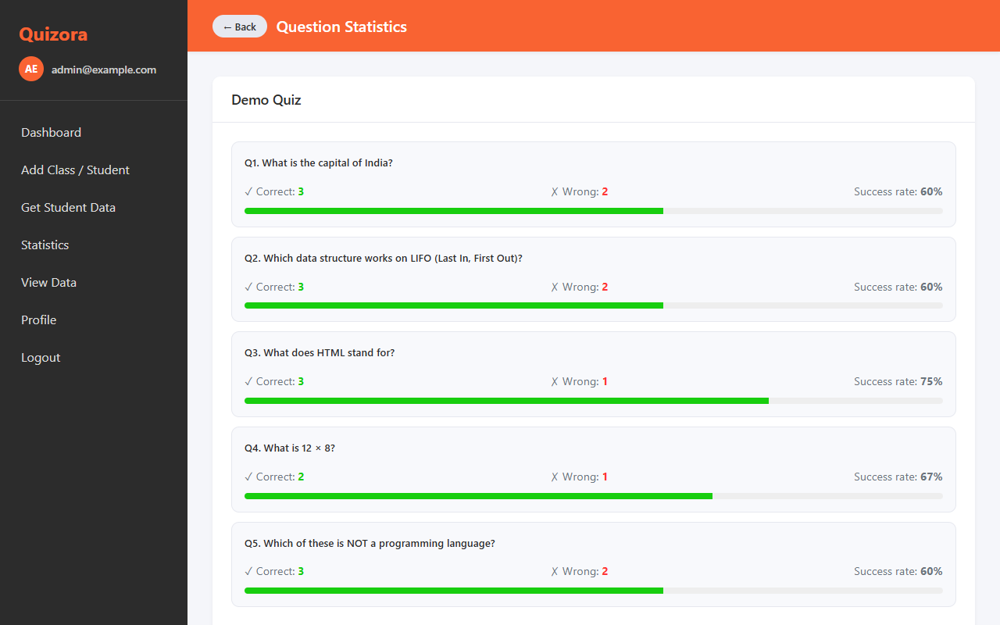

### 7. Manage your classes

**View Data** lists every class with its students. Click the **USN** or **Name** header to sort (click again to reverse). **Delete Class** removes the class and its students; a class that is still used by a test can't be deleted until you delete those tests.

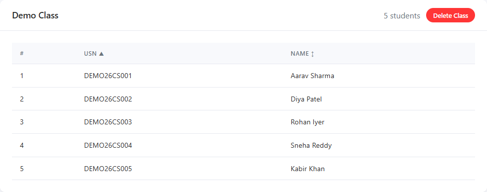

### 8. Your profile

Click **Profile** in the sidebar (or your picture at the top of it) to set your name, gender and profile picture, or change your password. Changing your password signs out your other devices.

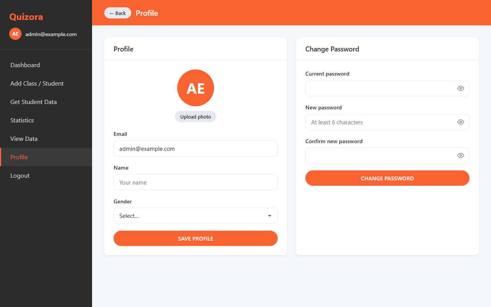

---

## Student guide

1. Open the app's home page and enter your **USN**, your **name** and the **password** your teacher gave you.

   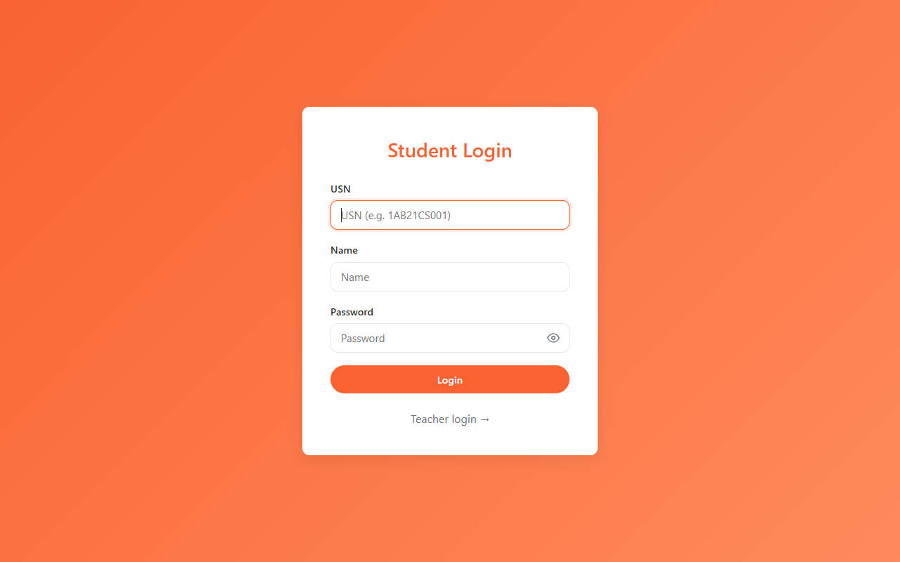

2. Wait until your teacher starts the test (status `RUNNING`), then click **Start Test**. For a proctored test, allow camera access when the browser asks.
3. Answer each question before the timer runs out (it counts down either per question or for the whole test, as your teacher chose). You can't go back to a previous question; in a whole-test timer you can **Skip** one.
4. Stay in fullscreen, don't switch tabs, keep your face visible and look at the screen. **3 warnings = the test is submitted automatically.**

---

## Developer guide

### Tech stack

- **Frontend** (`client/`): React 18 + Vite, React Router, Axios, SheetJS (Excel reading), MediaPipe Face Landmarker (webcam face tracking, self-hosted).
- **Backend** (`server/`): Node.js + Express, MongoDB with Mongoose, JWT auth, Nodemailer (verification and reset emails).
- **Hosting:** both on Vercel; database on MongoDB Atlas.

### Run locally

You need Node.js 18+ and a MongoDB database (local, or a free MongoDB Atlas cluster).

```bash
# Backend
cd server
cp .env.example .env      # then fill in the values (see below)
npm install
npm run seed              # optional: creates admin@example.com / admin and a sample class
npm run dev               # http://localhost:5000

# Frontend (new terminal)
cd client
npm install
VITE_API_URL=http://localhost:5000/api npm run dev   # http://localhost:5173
```

On Windows PowerShell, set the variable first: `$env:VITE_API_URL="http://localhost:5000/api"; npm run dev`.

> Change the seeded `admin` password (Profile → Change Password) before using it anywhere real.

### Environment variables (`server/.env`)

| Variable | What it's for |
|---|---|
| `MONGO_URI` | MongoDB connection string, including the database name (e.g. `/quizora`) |
| `JWT_SECRET` | Long random string used to sign logins. Changing it logs everyone out. |
| `JWT_EXPIRES` | Login lifetime, e.g. `7d` |
| `CLIENT_ORIGIN` | Frontend URL allowed by CORS, e.g. `https://your-app.vercel.app` (no trailing `/`) |
| `SMTP_HOST`, `SMTP_PORT`, `SMTP_USER`, `SMTP_PASS`, `MAIL_FROM` | Outgoing email for signup and password-reset codes. For Gmail: `smtp.gmail.com`, `465`, your address, and a Google **App Password**. If `SMTP_HOST` is empty, codes are printed to the server console instead. |

Frontend: `VITE_API_URL` points the app at the backend (with or without the trailing `/api`). It is read at **build** time, so redeploy the frontend after changing it.

### Deploy (Vercel)

Create two Vercel projects from this repository:

| Project | Root Directory | Notes |
|---|---|---|
| Backend | `server` | Framework preset **Other**. Add all the `server/.env` variables in Project Settings. `server/vercel.json` routes every request to `server/api/index.js`. |
| Frontend | `client` | Framework preset **Vite**. Set `VITE_API_URL` to the backend URL. |

In MongoDB Atlas, go to **Network Access** and allow `0.0.0.0/0`, because Vercel doesn't use fixed IP addresses. Pushing to `main` redeploys both projects.

### Maintenance scripts

Run these from `server/`. They use `MONGO_URI` from `.env`.

| Command | What it does |
|---|---|
| `npm run seed` | Creates the default teacher and a sample class |
| `node scripts/seedDemoResults.js` | Creates a completed **Demo Quiz** with sample answers (add `--remove` to delete it) |
| `node scripts/migrateTeacherOwnership.js` | One-off: gives existing classes and guest students an owner teacher (`--dry-run` to preview) |
| `node scripts/migrateRollnoToString.js` | One-off: converts old numeric roll numbers to USN text (`--dry-run` to preview) |

### Project layout

```
client/                React app
  public/mediapipe/    face-tracking model (WASM runtime is copied from node_modules at build)
  src/pages/           one file per screen
  src/components/      layout, sidebar, password input, avatar, face monitor
server/                Express API
  api/index.js         Vercel entry point
  controllers/ models/ routes/ middleware/
  scripts/             seed and migration scripts
docs/screenshots/      images used in this README
```
