# Quizora

Quizora is an online quiz app for colleges. Teachers create classes and tests, students sign in with their USN and the test's 4-digit access code, and the app proctors the test (fullscreen, tab-switch and webcam checks) and gives teachers per-student, per-question results.

- **Live app:** https://quiz-app-sigma-lemon-97.vercel.app
- **Teacher panel:** https://quiz-app-sigma-lemon-97.vercel.app/admin

**Contents**
- [Teacher guide](#teacher-guide)
  1. [Create an account or log in](#1-create-an-account-or-log-in)
  2. [Add your class and students](#2-add-your-class-and-students)
  3. [Create a test and add questions](#3-create-a-test-and-add-questions)
  4. [Give students their login details](#4-give-students-their-login-details)
  5. [Run the test](#5-run-the-test)
  6. [See the results](#6-see-the-results)
  7. [Manage your classes](#7-manage-your-classes)
  8. [Your profile](#8-your-profile)
- [Student guide](#student-guide)
- [Developer guide](#developer-guide)

---

## Teacher guide

### 1. Create an account or log in

Open **/admin**. If you are new, click **New teacher? Create an account**, fill in your name, email and password, and click **Send Verification Code**. Enter the 6-digit code that arrives by email and click **Create Account**.

Every teacher has a private account: you only ever see your own classes, students and tests.

| Log in | Create an account | Forgot password |
|---|---|---|
| 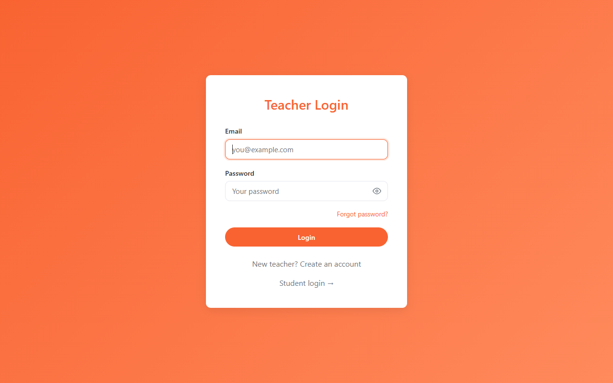 | 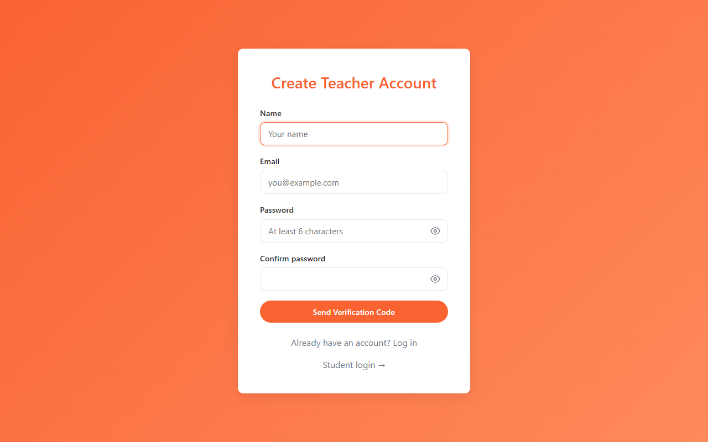 | 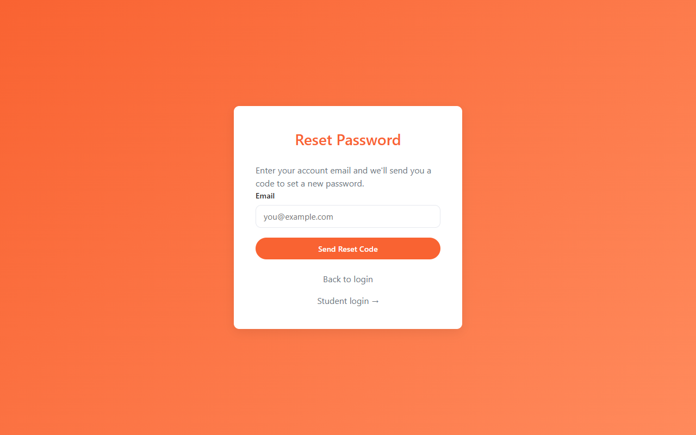 |

- **Forgot password?** Click it under the password box, enter your email, and you'll get a code to set a new password.
- The eye icon in a password box shows or hides what you typed.
- Codes are valid for 10 minutes. If one doesn't arrive, check your spam folder or click **resend code** after a minute.

### 2. Add your class and students

Go to **Add Class / Student** in the sidebar.

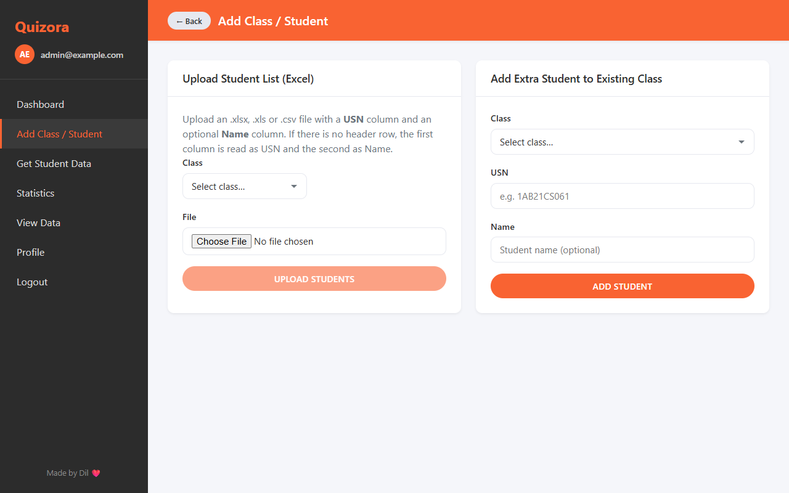

**Upload a student list (recommended).** Make an Excel (`.xlsx`, `.xls`) or `.csv` file like this:

| USN | Name |
|---|---|
| 1AB21CS001 | Asha Rao |
| 1AB21CS002 | Ravi Kumar |

The `Name` column is optional. If the sheet has no header row, column A is read as the USN and column B as the name. Choose **+ Create new class** (or an existing class), pick the file, check the count it shows, and click **Upload Students**. USNs already in the class are skipped, not duplicated.

**Add one student.** Use **Add Extra Student to Existing Class** for a late joiner.

USNs are not case-sensitive: `1ab21cs001` and `1AB21CS001` are the same student.

### 3. Create a test and add questions

On the **Dashboard**, click **+ New Test**. Fill in the name, subject, date, number of questions and class, then choose:

- **Status:** `PENDING` (students can't start yet) or `RUNNING` (students can start).
- **Mode:** `STANDARD` for a real, proctored test, or `MOCK` for practice: no timer, no proctoring, and students can retake it.
- **Enable webcam proctoring for this test:** see [Run the test](#5-run-the-test).
- **Timing:** *Per question* gives every question its own countdown (set on each question). *Total time for the whole test* gives one countdown, e.g. 30 minutes, for the whole test; questions still come one at a time with no going back, and students can **Skip** a question.
- **Shuffle questions and options for each student:** every student gets their own order of questions and of the four options, so neighbours can't copy by position. A student keeps the same order if they reconnect.
- **Opens at / Closes at (optional):** schedule the test. At the opening time a `PENDING` test switches to `RUNNING` by itself, and at the closing time it is marked `COMPLETED`. Answers sent after the closing time are refused, and a total-time countdown never runs past it. Students waiting on the dashboard see when the test opens. You can still change the status by hand. To reopen a test that closed automatically, move the closing time later. Leave both empty to start and end the test yourself.

Every student in the chosen class is enrolled automatically. The test also gets a random **4-digit access code**, shown only to you on the Dashboard, on **Test Details** and on **Student Credentials**. Every student uses the same code with their own USN, so you can write it on the board or say it out loud in the lab. If the code gets out, click **New code** on Test Details: students already logged in stay logged in, and new logins need the new code.

Then open the test from the Dashboard to reach **Test Details**:

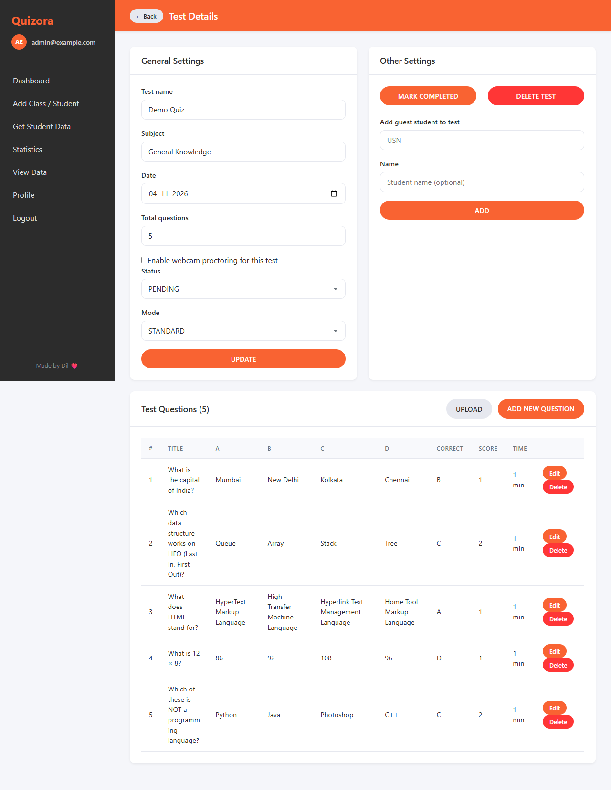

- **Add New Question:** choose the **question type**, then type the question, the answer, the marks and the time limit (in minutes). The types are:

  | Type | What the student does | How it's marked |
  |---|---|---|
  | **Single choice** | picks one of four options | right if it's the correct option |
  | **Multiple correct** | ticks every option that applies, then presses **Submit answer** | right only if they tick exactly the correct options (all-or-nothing) |
  | **True / False** | picks True or False | right if it matches |
  | **Numeric** | types a number, then presses **Submit answer** | right if it's within the tolerance you set (e.g. 9.81 ± 0.05); 0 means it must match exactly |

  For per-question timing, if time runs out after a student has ticked options or typed a number, that answer is still sent.
- **Pictures and diagrams:** click **Add a picture or diagram** under the question to attach a graph, circuit, map or photo. You can also drag a file onto that box, or click it and paste a screenshot with Ctrl+V. Single-choice and multiple-correct options can each have a picture too, with or without text, e.g. "Which graph shows uniform motion?" with four graphs as the answers. Students can tap a question's picture to see it full screen.
  - PNG, JPEG, WebP and GIF are accepted. Big pictures are shrunk in your browser before upload (to at most 1600 px), so they load quickly on students' phones.
  - Pictures are stored in your MongoDB database, since Vercel has no file storage. A typical diagram is 50–300 KB, so the free 512 MB Atlas tier holds a few thousand. Removing a picture, or deleting its question or test, deletes it from the database. Pictures you upload but never save are removed after a day.
  - Spreadsheet uploads are text only. Add pictures afterwards with **Edit** on the question.
- **Upload:** add many questions at once from an Excel file (`.xlsx`, `.xls`, `.ods`) with **no header row** and these columns in order:
  `question | option A | option B | option C | option D | correct | marks | time limit (minutes) | tolerance`

  The type is worked out from each row:

  | Type | Options | Correct | Tolerance |
  |---|---|---|---|
  | Single choice | all four | `B` | — |
  | Multiple correct | all four | `A,C` | — |
  | True / False | leave empty | `True` or `False` | — |
  | Numeric | leave empty | the number, e.g. `9.81` | optional, e.g. `0.05` |

  Rows with a mistake are skipped, and the upload says how many.
- **Add guest student to test:** enrol someone who isn't in the class, for this test only.
- **Mark Completed:** ends the test. **Delete Test:** removes the test, its questions and its results.

### 4. Give students their login details

Go to **Get Student Data** and pick the test.

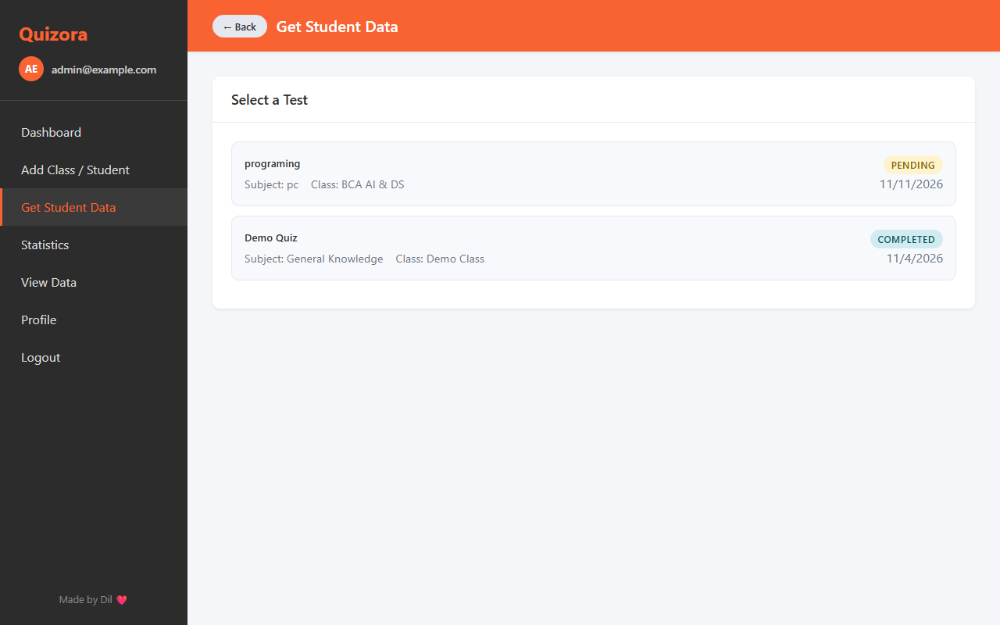

The **Student Credentials** page shows the test's access code in large digits and lists every student's USN and name, plus their live status, score and any violations.

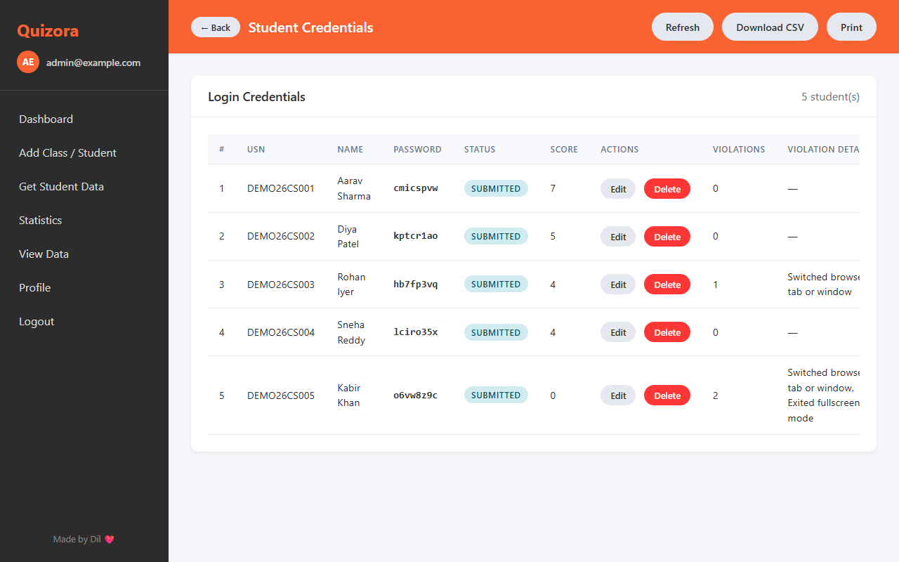

- **Print** prints the access code with the USN and Name columns.
- **Download CSV** saves the student list with violations.
- **Delete** removes a student from this test. To fix a student's USN or name, use **Edit** in the class list on **Add Class / Student**.
- **Refresh** reloads the list while the test is running.

### 5. Run the test

Set the test's **Status** to `RUNNING` on Test Details and click **Update**. Students can now log in and start.

During a `STANDARD` test the app:
- runs in **fullscreen** and blocks right-click, copy/paste and developer tools;
- runs the **countdown** you chose: per question (when it runs out, the next question loads) or for the whole test (when it runs out, the test is submitted). The total-time deadline is kept on the server, so reloading the page doesn't give extra time;
- counts a **warning** when the student switches tab or window, leaves fullscreen, or turns the camera off;
- with **webcam proctoring** on, also watches the student's face and counts a warning if they **look away** for about 2 seconds, **leave the camera view** for 3 seconds, or **someone else appears** on camera. The preview turns red ("Look at the screen!") first, so a quick glance is not punished.

On the **3rd warning** the test is **auto-submitted**. Face tracking runs entirely in the student's browser; no video is uploaded.

When everyone has finished, click **Mark Completed**.

### 6. See the results

Go to **Statistics** and pick a completed test.

To run a finished test again, click **Retake** next to it. This makes a new test named like "Unit Test (Retake)". It has the same questions and settings, the class's current students plus any guest students, and its own new access code. The new test starts as `PENDING` with no schedule, so you can check it and then start it. The original test and its results stay in Statistics.


**Test Statistics** shows each student's score, whether they submitted (or were auto-submitted) and their violations. **Print** prints the #, USN, Name and Score columns.

**Export to Excel** downloads the results as an `.xlsx` workbook with three sheets:
- **Results:** a summary (class, number of students, average score), then one row per student with rank, USN, name, score, percentage, right/wrong/not answered, status and violations.
- **Answers:** every student's answer to every question, marked ✓ or ✗, with the correct answers on the first row.
- **Questions:** each question's type, correct answer and how many students got it right.

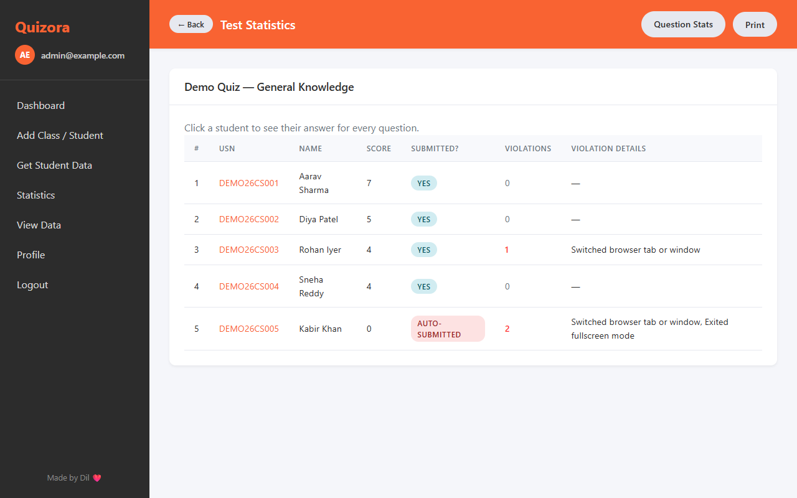

**Click a student** to see exactly what they answered for every question, with the correct answer and the marks.

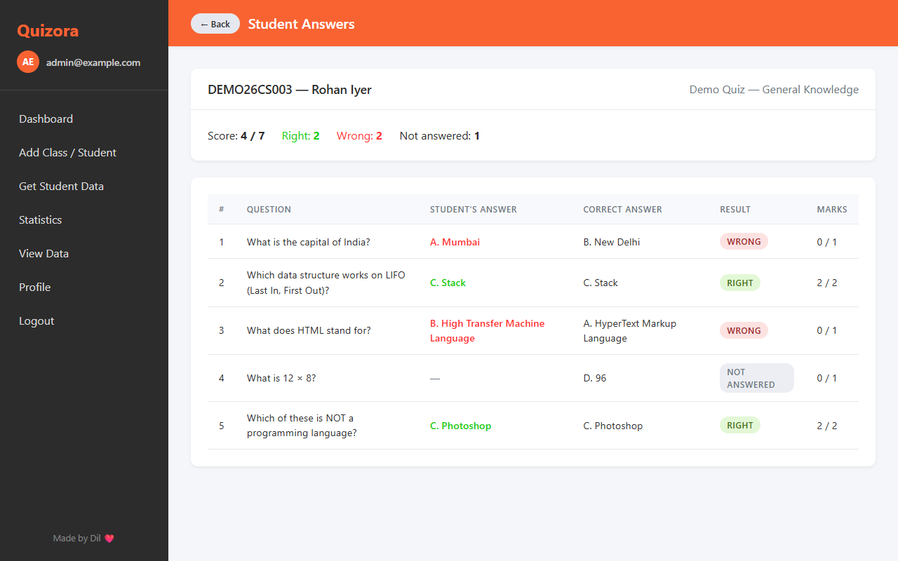

**Question Stats** shows how many students got each question right or wrong, so you can spot difficult questions.

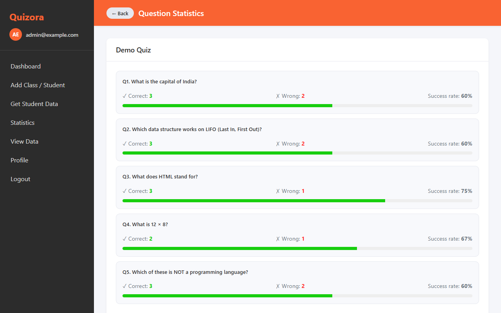

### 7. Manage your classes

At the bottom of **Add Class / Student**, **Classes and Students** lists every class with its students, and updates as soon as you add students. **Edit** fixes a student's USN or name (press Enter to save, Esc to cancel), and every test shows the change. **Delete** removes a student from the class and from tests they haven't started; results from tests they already took are kept. Click the **USN** or **Name** header to sort (click again to reverse). **Delete Class** removes the class and its students; a class that is still used by a test can't be deleted until you delete those tests.

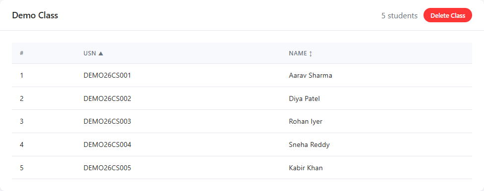

### 8. Your profile

Click **Profile** in the sidebar (or your picture at the top of it) to set your name, gender and profile picture, or change your password. Changing your password signs out your other devices.

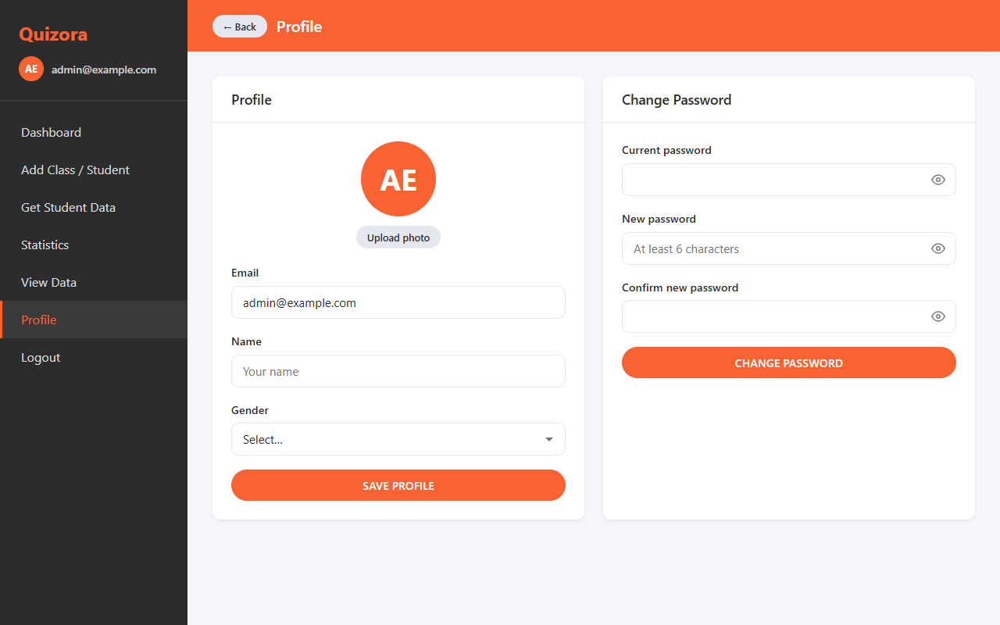

---

## Student guide

1. Open the app's home page and enter your **USN** and the **4-digit access code** your teacher gives out for the test.

   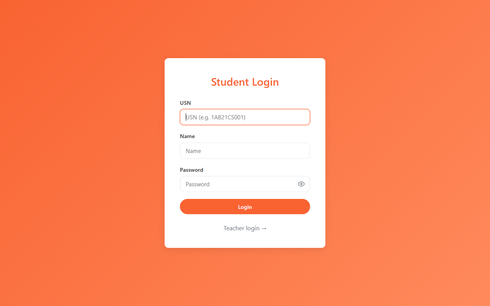

2. Wait until your teacher starts the test (status `RUNNING`), then click **Start Test**. For a proctored test, allow camera access when the browser asks.
3. Answer each question before the timer runs out (it counts down either per question or for the whole test, as your teacher chose). You can't go back to a previous question; in a whole-test timer you can **Skip** one.
4. Stay in fullscreen, don't switch tabs, keep your face visible and look at the screen. **3 warnings = the test is submitted automatically.**
5. When the test is submitted, you see your own score (marks, percentage and how many answers were right). You only see it after submitting, never during the test, and only for your own test. Log in again with the same USN and code to see it later.

---

## Android app

For proctored tests, students can use the **Quizora Android app** instead of Chrome. It opens the same website, but it blocks screenshots, screen recording and assistants that read the screen (Circle to Search, Gemini). During a test it pins itself so students can't switch apps. Download the APK from the [android-latest release](https://github.com/mohdadil1/Quiz-app/releases/tag/android-latest). How it works, updates and signing are covered in [android/README.md](android/README.md).

## Developer guide

### Tech stack

- **Frontend** (`client/`): React 18 + Vite, React Router, Axios, SheetJS (Excel reading), MediaPipe Face Landmarker (webcam face tracking, self-hosted).
- **Backend** (`server/`): Node.js + Express, MongoDB with Mongoose, JWT auth, Nodemailer (verification and reset emails).
- **Hosting:** both on Vercel; database on MongoDB Atlas.

### Run locally

You need Node.js 18+ and a MongoDB database (local, or a free MongoDB Atlas cluster).

```bash
# Backend
cd server
cp .env.example .env      # then fill in the values (see below)
npm install
npm run seed              # optional: creates admin@example.com / admin and a sample class
npm run dev               # http://localhost:5000

# Frontend (new terminal)
cd client
npm install
VITE_API_URL=http://localhost:5000/api npm run dev   # http://localhost:5173
```

On Windows PowerShell, set the variable first: `$env:VITE_API_URL="http://localhost:5000/api"; npm run dev`.

Run the server's unit tests (question grading and scheduling; no database needed) with `cd server && npm test`.

**Large exams (hundreds to 1000+ students at once):**
- One answer costs 6 database round trips, the last two in parallel. The Test Statistics page uses a fixed handful of queries however big the class, and per-question counters use atomic `$inc`, so simultaneous answers don't overwrite each other.
- Waiting students check the dashboard every 10–20 seconds at random, plus once just after a scheduled opening time. Teacher pages refresh every 10 seconds and pause in background tabs.
- Mongoose creates the indexes this needs automatically the first time the new code starts. On a big existing database, deploy outside exam hours.
- Each server copy keeps at most `MONGO_POOL_SIZE` (default 10) database connections. Vercel runs many copies under load, so keep copies × pool size under your cluster's connection limit (500 on Atlas free and shared tiers). For real exams of this size, use a dedicated (paid) Atlas cluster, and run `scripts/loadTestCQuiz.js` with `LOAD_TEST_STUDENTS=1000` against a test deployment first.

**Question pictures** live in the `questionimages` collection and are served publicly from `GET /api/images/:key`. Each key is a random 128-bit id, so pictures can't be guessed before a test. Responses are cached for a year by browsers and Vercel's CDN, which is safe because a picture never changes under its key. Uploads are checked by their actual bytes, not the file name, and SVG is refused because it can contain scripts.

**Rate limits:** to stop code and password guessing, the login and emailed-code endpoints are rate-limited (see `server/middleware/rateLimit.js`). A student is blocked for 15 minutes after 10 wrong access codes for the same USN. The limit is counted per IP *and* USN, so a whole exam hall behind one college IP isn't locked out by one student. Teacher logins work the same way per email, and verification codes can be requested 5 times an hour per email. The counters are kept in memory, so on Vercel each server instance counts separately; add a shared store (Redis or MongoDB) if you need one global limit.

> Change the seeded `admin` password (Profile → Change Password) before using it anywhere real.

### Environment variables (`server/.env`)

| Variable | What it's for |
|---|---|
| `MONGO_URI` | MongoDB connection string, including the database name (e.g. `/quizora`) |
| `JWT_SECRET` | Long random string used to sign logins. Changing it logs everyone out. |
| `JWT_EXPIRES` | Login lifetime, e.g. `7d` |
| `CLIENT_ORIGIN` | Frontend URL allowed by CORS, e.g. `https://your-app.vercel.app` (no trailing `/`) |
| `SMTP_HOST`, `SMTP_PORT`, `SMTP_USER`, `SMTP_PASS`, `MAIL_FROM` | Outgoing email for signup and password-reset codes. For Gmail: `smtp.gmail.com`, `465`, your address, and a Google **App Password**. If `SMTP_HOST` is empty, codes are printed to the server console instead. |

Frontend: `VITE_API_URL` points the app at the backend (with or without the trailing `/api`). It is read at **build** time, so redeploy the frontend after changing it.

### Deploy (Vercel)

Create two Vercel projects from this repository:

| Project | Root Directory | Notes |
|---|---|---|
| Backend | `server` | Framework preset **Other**. Add all the `server/.env` variables in Project Settings. `server/vercel.json` routes every request to `server/api/index.js`. |
| Frontend | `client` | Framework preset **Vite**. Set `VITE_API_URL` to the backend URL. |

In MongoDB Atlas, go to **Network Access** and allow `0.0.0.0/0`, because Vercel doesn't use fixed IP addresses. Pushing to `main` redeploys both projects.

### Maintenance scripts

Run these from `server/`. They use `MONGO_URI` from `.env`.

| Command | What it does |
|---|---|
| `npm run seed` | Creates the default teacher and a sample class |
| `node scripts/seedDemoResults.js` | Creates a completed **Demo Quiz** with sample answers (add `--remove` to delete it) |
| `node scripts/migrateTeacherOwnership.js` | One-off: gives existing classes and guest students an owner teacher (`--dry-run` to preview) |
| `node scripts/migrateRollnoToString.js` | One-off: converts old numeric roll numbers to USN text (`--dry-run` to preview) |

### Project layout

```
client/                React app
  public/mediapipe/    face-tracking model (WASM runtime is copied from node_modules at build)
  src/pages/           one file per screen
  src/components/      layout, sidebar, password input, avatar, face monitor
server/                Express API
  api/index.js         Vercel entry point
  controllers/ models/ routes/ middleware/
  scripts/             seed and migration scripts
docs/screenshots/      images used in this README
```
